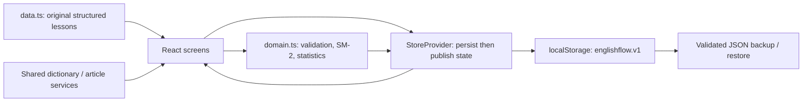

# Architecture

Current Android 1.7 additions: `assessment.ts` provides bounded local Writing rules and a bundled spelling lexicon; `LearningAssessment.tsx` handles revision, persisted checked state and request-scoped feedback. Native `Pronunciation.java` decodes private recordings, runs pinned ONNX Wav2Vec2 phoneme inference and aligns CMU phones; `MainActivity` serializes work and cancels obsolete generations. Native weights stay outside `dist` and service-worker caches. `content/expansion.json` is reviewed input to the existing importer, not runtime learner state. Current counts and limits are in README; older component inventory below is historical.

## Cập nhật 1.6.0

Android canonical state nằm trong SharedPreferences qua `readState/saveState`; chỉ publish React state sau commit thành công. localStorage trên Android là cache có thể cũ sau force-stop. Browser vẫn dùng localStorage; backup version 1 thêm trường Writing có validation, không đổi ID hoặc lịch ôn cũ.

`import-open-content.py` + `content/editorial.json`/`packs.json` tạo catalog/manifest và `open-content-data.ts` từ cache có SHA-256. `curriculum.ts` chứa giáo trình tự biên soạn; `learning-content.ts` chứa đề viết/hội thoại; `learning-plan.ts` chọn nhiệm vụ ngày từ profile và sự kiện thật. `MobileLearning.tsx` nối các luồng này, `ContentCredits.tsx` dùng chung cho mobile và desktop. Thư viện gốc vẫn là dữ liệu chỉ đọc; bộ mới chỉ vào owned collections khi người dùng thêm.

APK host không có quyền Internet, dùng asset HTTPS nội bộ và blob cho media nhỏ. Bản thu hoạt động dùng file riêng không bị Android thu hồi cache giữa lúc nghe; bỏ bản cũ khi khởi động và khi hủy Activity. Service worker web precache content/media/font/books/art, xử lý Range để tua offline; shard từ điển web chỉ cache sau khi dùng. Không có iOS hay backend được cấu hình.

Phần bên dưới giữ lịch sử kiến trúc ban đầu; các đoạn mô tả localStorage Android/từ điển mẫu nhỏ đã được thay bằng cơ chế trên.

## Android entry added after APK investigation

`mobile.html` → `mobile-main.tsx` → `MobileApp.tsx` uses the same store, domain functions, dictionary, review, reading, media and quiz engines as the desktop entry. `mobile.css` provides a distinct phone layout with five bottom tabs, a word bank, collection covers, Explore cards and shadowing. Hash routes support Android Back and sentence/lesson navigation. The desktop entry remains `index.html`.

`android/` is a Java Android host using the platform WebView and Android SDK, without a Capacitor/React Native runtime. All production assets are packaged from `dist` and served from an intercepted local HTTPS origin. Requests outside that origin are rejected; external HTTPS navigation opens a browser. CSP blocks remote scripts/frames, file access is disabled, no network permission is requested, and native bridge methods validate text/filename/size boundaries. This is a hybrid Android app, not a native reimplementation of 4English's fragments.

`native.ts` defines the bridge for Android TextToSpeech, bounded 30-second microphone recording, local playback and system file save/open dialogs. Recording stays in app cache, is replaced by a later attempt and deleted on normal Activity destruction; OS cache/process eviction can also remove it. Recording/playback release resources on backgrounding/navigation. A denied or missing voice/microphone reports an explicit fallback. No speech recognition, acoustic scoring or audio upload is implemented.

On Android, the small bundled media files are fetched into local Blob URLs so Chromium can seek without relying on HTTP Range behavior of intercepted WebView streams. The source is canceled/revoked on unmount. Long media should use a native streaming provider instead. Android storage is the WebView's private localStorage; browser and APK data are separate. JSON backup uses Android's document picker and validated restore; there is no cloud account.

Gradle 8.9 / AGP 8.5.0, compile/target SDK 36, min SDK 28, application ID `com.englishflow.mobile`. The supplied artifact uses the local Android debug certificate for sideload testing; production/store signing is not configured. `npm run build:android` rebuilds assets and APK through the checked-in wrapper.

## Repository decision

`D:/ReactJS` is a multi-project workspace; `git status` there and in `HocTuVung` reported no valid Git repository. `Rea-HSK-Reference` is the supplied REA tool repository, not a learning application. It already had an untracked `rea-agents-6.7.0.tgz`; it was preserved. `HocTuVung` is a separate React 18/Vite vocabulary demo with its own storage and HTML material. No existing EnglishFlow application, schema, tests or backend was present. No other project/configuration/data was edited. New app files live only in `EnglishFlow`.

React 18/Vite matches a proven stack in this workspace. TypeScript provides entity contracts; native CSS handles layout and native dialog/media elements handle focus and playback. Lucide is the only additional runtime library. No Redux, router, component framework, auth simulation or backend scaffold.

## Data flow

- `model.ts`: typed Word, SavedWord, Collection, Article, translation paragraph, MediaLesson, timed Segment, GrammarLesson, Question, StudyEvent, profile and versioned state.
- `data.ts`: stable IDs, 36 words/phrases, 7 collections, 4 readings, 3 media lessons, 8 grammar topics. English/Vietnamese are separate fields. Questions keep answers/explanations in data.
- `dictionary-service.ts`: one local search/lookup provider used by dictionary page and shared dialog. `TextLookup` links supported tokens in reading/transcripts/examples; unsupported words have an explicit seed-dictionary empty state. Phrases are searchable as whole terms. No external dictionary request is currently made.
- `content-service.ts`: typed local article provider (`list`, `get`). A remote feed needs an asynchronous adapter, legal attribution, timeouts, loading/error UI and a server for secrets. None is represented as configured today.
- `domain.ts`: pure SM-2 scheduling, response normalization, statistics, safe ID/data validation and imports. Node assert checks exercise real invariants.
- `store.tsx`: Context with a current-state ref. Successful synchronous `localStorage.setItem` precedes publishing new UI state. Storage failures report errors. Invalid startup data is not overwritten. Browser storage events synchronize tabs; this is last-write-wins, not transactional cross-device persistence.
- `components.tsx`: native modal dictionary, shared WordEntry, word links, media cards and quiz engine. Quiz results are persisted once on finishing; repeat runs are separate attempts.
- `App.tsx`: hash navigation, including reading, listening and grammar lesson IDs. Reload, browser back/forward and deep links work without SPA server rewrites.

## Review algorithm and statistics

SM-2 recall ratings are Again=1, Hard=3, Good=4, Easy=5. Ease changes by `0.1 − (5−q)×(0.08+(5−q)×0.02)`, floor 1.3. Success intervals: first 1 day, second 6 days, thereafter `round(previous interval × updated ease)`. Failure resets repetitions and interval, increments lapses, and returns the card in 10 minutes. All first successful ratings produce 1 day, as in the documented algorithm; the UI does not promise different initial intervals. The session freezes the due queue at entry and persists each rating. It does not auto-loop a failed card within the same session.

Word schedule and review event are saved in the same localStorage object update. No randomized metrics are seeded. “Learned” means current repetitions > 0, not established mastery. Review accuracy uses actual recall ratings >=3. Lesson attempts retain score, total, mistakes and timestamp. “Practiced lesson” includes attempts with mistakes. Study time uses 15-second foreground-tab samples, capped to one sample after timer throttling; it does not measure attention and can lose the final partial interval. Streaks and calendar activity use the device's local date; due times use epoch milliseconds. Weekly charts display the last seven dates.

Reading progress is a manually saved paragraph index, not a guessed completion event. Recent article order follows the last save. A reading exercise produces the reading attempt event. Media position is saved at 5-second changes, pause/end and explicit save. Native controls supply seek/play/pause/duration. Clicked transcript lines set currentTime, play, then pause at the segment end (timeupdate granularity). Caption/translation toggles affect the transcript and synchronized text below the video; captions are not burned into the video.

## Offline, media and deployment

`scripts/build-sw.mjs` generates a versioned service worker from production asset hashes. It precaches only the app shell and same-origin build assets. Cached local readings, dictionary and grammar are bundled in JavaScript. Media and third-party fonts are not precached. The static cache ignores Vary for immutable owned assets because module requests carry Origin while install prefetches may not. New worker activation follows normal browser lifecycle; all existing app tabs may need closing to activate a waiting build. No dev service worker is registered.

Host `dist/` at an origin root over HTTPS (localhost is supported). No secrets, environment variables or network APIs are required. Deploying under a URL subdirectory requires changing Vite base, manifest, media and service-worker paths together. The 2 audio/1 video original lessons have timestamps matching fixed 8-second narration slots. `garden.wav` is a video-generation source; only `garden.webm` is exposed as that lesson's player.

## Security and migration boundary

Inputs have size/length/type validation. Imported IDs reject prototype-related names. React escapes content; imported strings are rendered as text, not HTML. No API keys/passwords/tokens are stored. Notes/backup are plain local data. Profiles on the same browser origin share data. There are no protected server endpoints or production authentication claims. Origin/profile isolation is not account authorization.

A future Spring Boot/PostgreSQL backend should own users, password hashing/sessions, ownership constraints, review transactions and server timestamps. Preserve stable content IDs, attach user IDs to private tables, migrate versioned backup data with validation, and keep dictionary/feed/AI provider keys on the server. A remote API changes the synchronous provider boundary and requires loading/timeout/retry handling. No database or migration command exists in this prototype.
